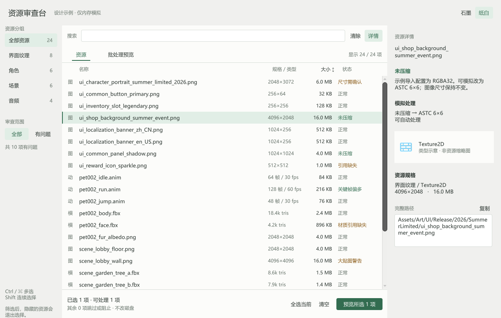
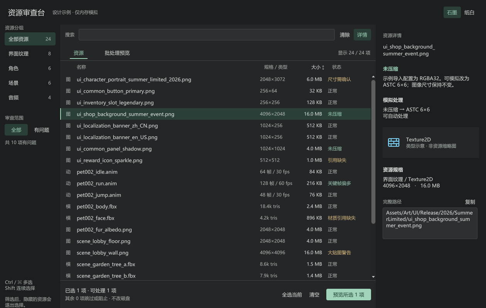
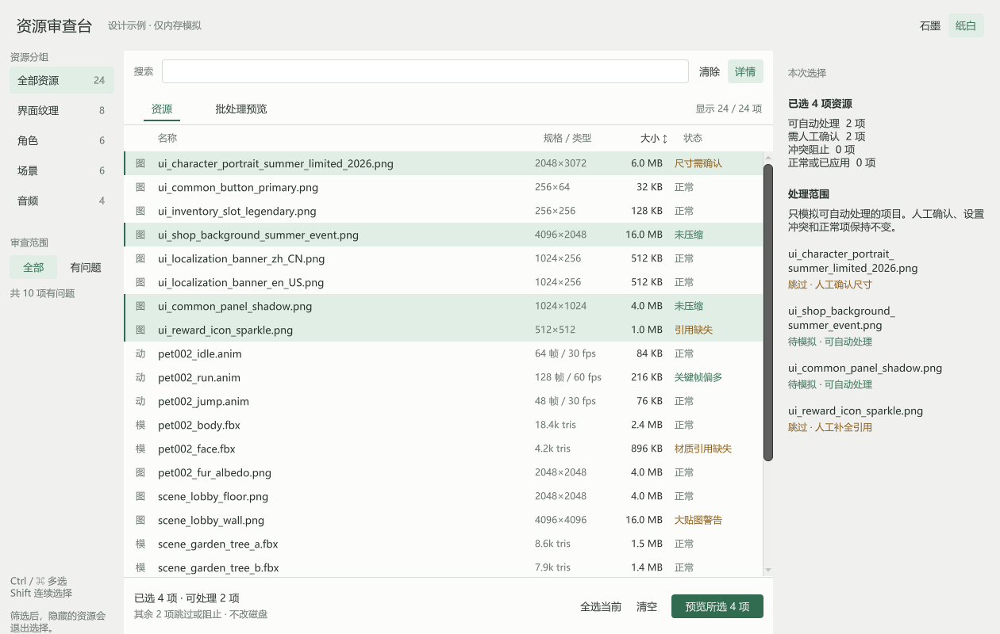
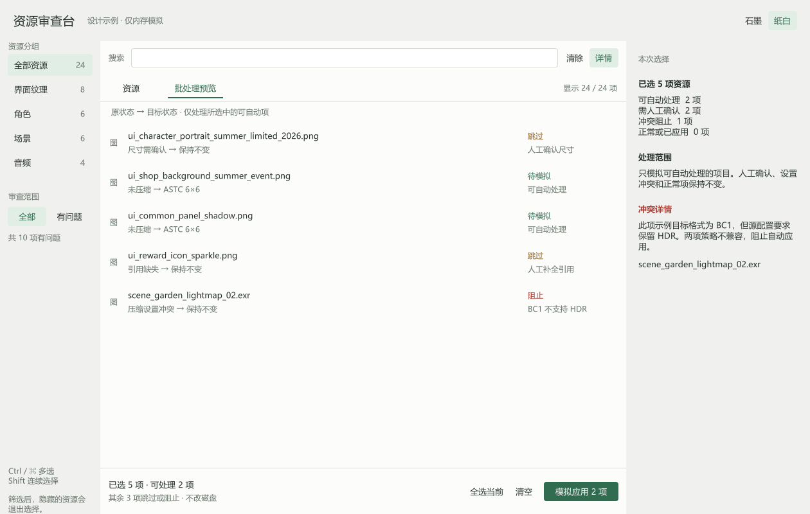
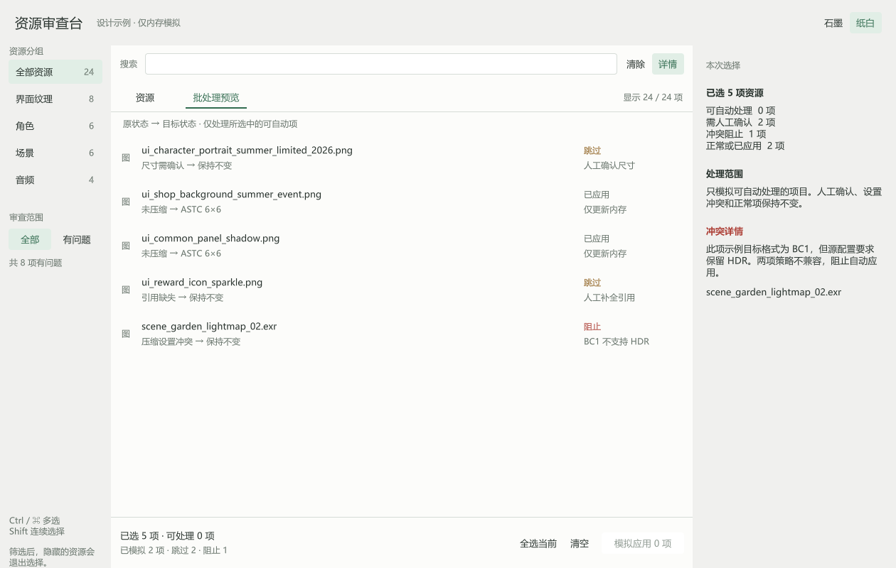
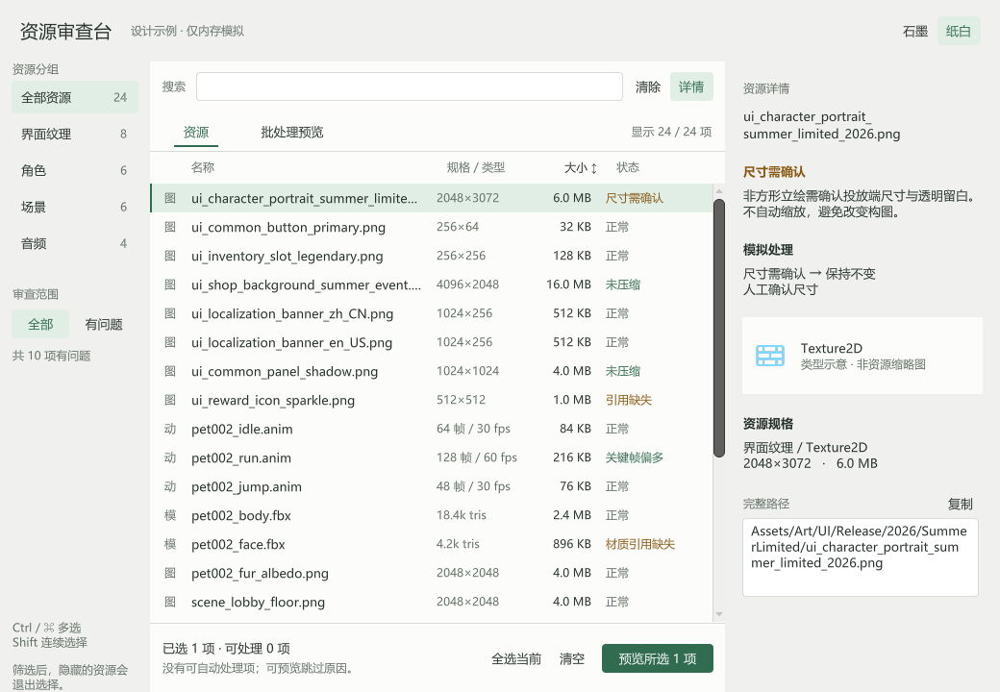
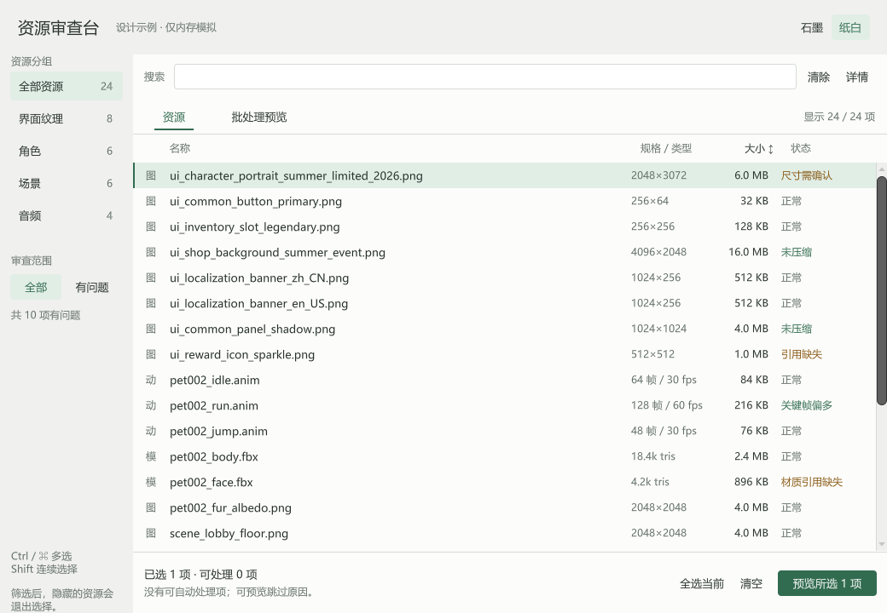
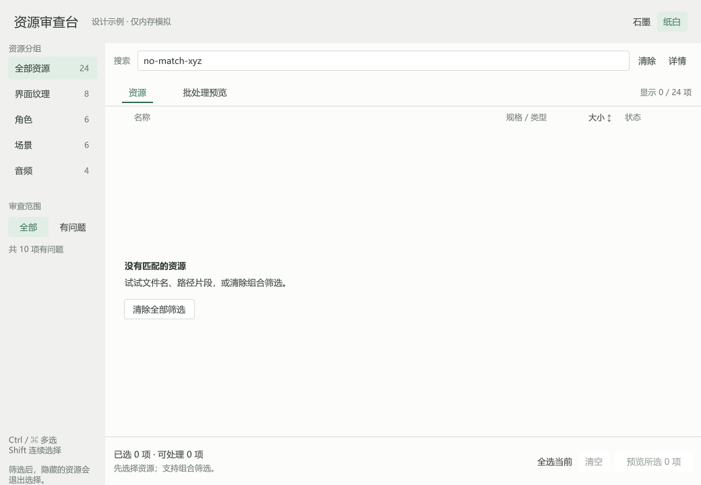

# 复杂资源审查台

用24条**内存假数据**检验字体、配色和高密度交互，而不是对真实工程执行资源检查。示例不扫描、不导入、不改名，不调用 AssetDatabase。

## 在 Unity 中运行

1. 将本目录中的 `AssetReviewWindow.cs` 和 `ReviewFont.cs` 一起复制到目标项目的 `Assets/Editor/UnityEditorDesignDemo/`。
2. 等待 Unity 编译。
3. 打开菜单 **Tools → 设计示例 → 资源审查台**。

不需要 MCP、Pipeline 或其它插件。验证版本为 Unity 2022.3.62f2；其他版本先复核 UI Toolkit / TextCore API。示例代码应仅放 Editor 目录。

## 覆盖场景

- 24个资源、4个分组、三栏：分组 / 表格 / 详情。
- 长文件名、完整路径、英文类型、大小、尺寸、动画与音频参数。
- 分组、搜索、问题过滤叠加；按大小排序；Ctrl/Shift 多选。
- 详情可收折；过滤隐藏的资源退出选择，不显示旧对象。
- 多选可自动处理、需人工、配置冲突三类对象。
- 批处理展示原状态、目标状态、跳过/阻止原因；模拟应用只改变假数据，数量与结果同步。
- “复制”按用户操作写入系统剪贴板；不会读取该假路径的实际文件。

默认尺寸1260×800，最小1040×720。使用虚拟化列表，但只有24条样例，没有证明千级资源性能。

## 纸白与石墨

两套集中调色板使用同一批数据。颜色切换仅作用于此窗口，不修改 Editor 全局主题；不能因此宣称所有原生浅色控件均已验证。





## 混合多选与冲突



批处理图包含2项可自动处理、2项需人工、1项策略冲突。只模拟前两项，其余保持原状态。





## 窄窗与空态







## 字体方案

`ReviewFont` 先检查系统是否安装 Microsoft YaHei UI，然后调用：

```csharp
var asset = UnityEngine.TextCore.Text.FontAsset.CreateFontAsset(
    "Microsoft YaHei UI", "Regular", 64);
root.style.unityFontDefinition = FontDefinition.FromSDFFont(asset);
```

64是字体资产采样字号，不是界面字号。Regular/Bold 分别建内存资产并映射真实字重；关闭窗口释放自建资产。这里是 TextCore `FontAsset`，不是 `TMP_FontAsset`。

未附字体文件，不复制系统字库，不把字库图集写入项目。其它系统不存在该字体时继承 Editor 字体，外观可能不同，需要再次渲染。字体自身许可仍然适用。

## 验证与限制

示例在 Windows、Unity2022.3.62f2、缩放1下通过编译，做过20项程序化状态/布局/字体检查，并对上述尺寸和状态截图作过独立视觉审查。

尚未验证真实浅色Editor、停靠、高DPI、多屏、macOS/Linux字库、完整真实键鼠与无障碍操作；也没有真实资产导入、Undo、权限或磁盘冲突逻辑。只有类型示意图标，没有真实资源缩略图。

这是演示，不是生产资源工具；此示例的改进不代表 skill 已证明稳定跨会话审美增益。详见 [验证范围](../../references/validation.md)。
